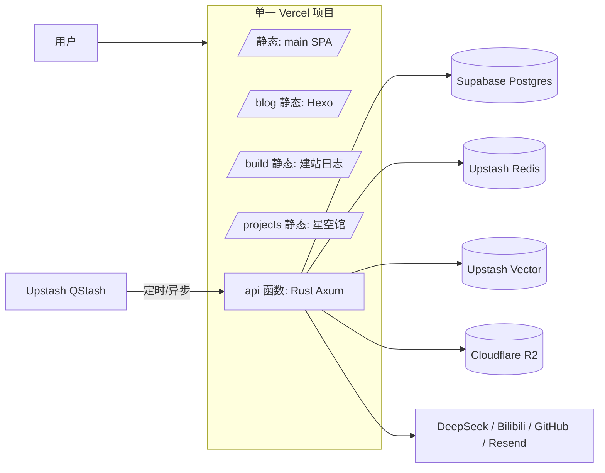

# taozhiyy.top 迁移方案 v3：单一 Vercel 项目 + 单一 SPA + Rust Axum 后端

> v3 核心变化：**不再有四个独立前端**。文章（/blog）、建站日志（/build）、星空馆（/projects）全部并入 main 这一个 SPA 的路由，跳转是客户端路由切换，不再是独立 HTML 文档。
> 后端不变：Rust Axum 作为同一 Vercel 项目里的 serverless 函数；数据库 Supabase Postgres；媒体 Cloudflare R2；缓存/定时/检索用 Upstash Redis / QStash / Vector。
> 节奏仍按你选的**一次性重写切换**。

---

## 0. v3 变更记录（对 v2 的修正，2026-11-11）

| v2 方案 | v3 修正 | 原因 |
|---|---|---|
| blog/build/projects 各自独立 HTML 文档，由 vercel.json rewrite 按路径分发 | 三者改为 main SPA 内的 React Router 路由（`/blog/*`、`/build/*`、`/projects/*`），只发 `index.html` 一份入口 | 用户要求统一集中到 SPA 路由 |
| Hexo `hexo generate` 产出 `blog/public` 整站 | **Hexo 降级为构建期内容编译器**：只用它展开 Butterfly 标签插件并抽取文章正文，产出 `posts.json`（元数据 + 正文 HTML）喂给 SPA；Butterfly 主题不再上线 | 28 篇文章用了 Butterfly 标签插件 800+ 处（span 343、folding 163、note 145、checkbox 124、label 121、image 97 等），自己实现这些标签成本极高，而 Hexo 编译期展开它们是现成能力 |
| `build/` 独立 React 19 + TS 子站，`base: '/build/'` | 源码迁入 `main/src/subapps/journal/`，作为 `/build/*` 子路由；原目录结构保留（避免改 import），去掉自己的 BrowserRouter；全局 CSS 用 `postcss-prefix-selector` 作用域化 | 依赖无冲突（TSX 由 Vite 直接转译），主要工作是路由嵌套与 CSS 隔离 |
| `previews/project-gallery` 独立 vite 构建，`--base=/projects/` | 包装成 React 组件挂到 `/projects` 路由：原生 JS + Three.js 需补 `destroy()`（RAF、ResizeObserver、监听、OrbitControls/renderer dispose），CSS 作用域化 | 星空馆无 React、无路由，React 卸载时必须完整清理 WebGL |
| vercel.json SPA fallback 负向排除 `/blog`、`/build`、`/projects`、`/ai-assistant` | 只需排除 `/ai-assistant`（静态资源）和未来的 `/api`；其余全部走 SPA fallback | 静态子站路径消失 |
| 导航栏三个入口是 `<a>` 原生跳转 | 改回 `<Link>` 客户端路由 | 已在同一 SPA 内 |

---

## 1. 目标形态

一个 Vercel 项目，域名 `taozhiyy.top`，路径即目录：

| 路径 | 内容 | 来源 |
|---|---|---|
| `/`、`/moments`、`/friends`、`/app` … | 主站页面 | `main/`（React Router） |
| `/blog/*` | 文章列表/详情（SPA 路由） | `main/src/subapps/blog/`，内容由 Hexo 编译成 `posts.json` |
| `/build/*` | 建站日志（SPA 路由） | `main/src/subapps/journal/`（自 build/ 迁入） |
| `/projects` | 星空馆（SPA 路由） | `main/src/subapps/cosmos/`（自 previews/project-gallery 迁入） |
| `/ai-assistant/...` | 全站 AI 助手浮窗 | `shared/ai-assistant/`（唯一保留的静态目录） |
| `/api/...` | Rust Axum 后端 | `api/`（vercel-rust 函数） |



好处：同域同源（cookie、CORS、相对路径都最省心）、版本原子（一个 git commit 对应整站一次发布）、DNS 切换只有一笔。代价是**构建耦合**：任何一个子站构建失败，整站都不能发新版（见风险第 3 条）。

---

## 2. 仓库变化

```
rustblog/
  vercel.json            # 新增：构建命令、输出目录、函数、rewrites
  tools/
    vercel-build.mjs     # 新增：合并构建脚本（编排下面 5 步）
  api/                   # 新增：Rust Axum crate（Cargo.toml + src/ + vercel handler 入口）
  main/ blog/ build/ previews/project-gallery/ shared/ai-assistant/   # 原样保留
  acg-api/               # 过渡期保留，切换后移除/归档
```

### 2.1 合并构建流水线（`tools/vercel-build.mjs`）

> **已实现（2026-11-11）**：`tools/vercel-build.mjs` 与根目录 `vercel.json` 已落地并跑通完整构建。脚本支持 `--skip-install`（复用 node_modules）与 `--only main,blog,build`（只构建部分子站）；因 `build/package.json` 的 build 脚本自带 `content:build`，Python 步骤不单独再跑。`tools/build-project-gallery.mjs` 已改为优先读 `VERCEL_GIT_COMMIT_SHA`、无 `.git` 时回退 `local`。`out/` 已加入 `.gitignore`。

按顺序执行，任何一步失败即中断（Vercel 构建失败 = 不发版）：

1. `cd build && python3 build_content.py` —— 把 `build/content/articles/*.md` 转 HTML 与 `content.json`（Vercel 构建镜像自带 python3；版本不符时用 `python3.11` 显式调用或锁版本）。
2. `cd build && npm ci && npm run build` —— 产出 `build/dist`（vite `base: '/build/'` 已有）。
3. `cd blog && npm ci && npx hexo generate` —— 产出 `blog/public`（`root: /blog/` 已有，不用改）。
4. `cd main && npm ci && npm run build` —— 产出 `main/dist`；其 build 脚本会顺带跑 `tools/build-project-gallery.mjs` 把星空馆打进 `main/dist/projects`（该脚本用 `git rev-parse HEAD` 写 release.json，Vercel 构建环境有 git，无问题；本地挂载目录没有 .git 时需跳过这一步）。
5. **组装输出 `out/`**：
   - `main/dist/*` → `out/`（根）
   - `blog/public/*` → `out/blog/`
   - `build/dist/*` → `out/build/`
   - `shared/ai-assistant/*` → `out/ai-assistant/`（原先靠部署脚本单独 rsync，现在必须显式拷入）
6. Vercel 侧同时用 vercel-rust runtime 构建 `api/index.rs` 函数（与静态构建并行）。

`vercel.json` 模板（**runtime 名称/版本以 vercel-rust 当前文档为准，见风险 1**）：

```json
{
  "buildCommand": "node tools/vercel-build.mjs",
  "outputDirectory": "out",
  "functions": {
    "api/index.rs": {
      "runtime": "vercel-rust@latest",
      "maxDuration": 300,
      "memory": 1024
    }
  },
  "rewrites": [
    { "source": "/api/(.*)", "destination": "/api/index" },
    {
      "source": "/((?!api/|blog/|build/|projects/|ai-assistant/|assets/|.*\\.(?:js|mjs|css|map|html|png|jpg|jpeg|webp|avif|svg|ico|gif|json|txt|xml|webmanifest)$).*)",
      "destination": "/index.html"
    }
  ]
}
```

两个必须注意的点：

- **SPA fallback**：main 是 React Router 客户端路由（`/moments`、`/friends` 等），需要最后那条 catch-all rewrite 兜底到 `index.html`；同时用负向先行排除 `/api`、`/blog`、`/build`、`/projects`、`/ai-assistant` 和静态文件后缀，防止把子站和资源吞进 SPA。这条正则**必须在 Preview 环境用真实路径逐个验收**（Vercel 的 rewrite 优先级风险见第 8 节第 4 条）。
- **API 函数段暂未启用**：当前仓库里的 `vercel.json` 只含静态构建与 SPA fallback，`functions` 与 `/api/(.*)` rewrite 待 `api/` Rust crate 落地后再加，避免引用不存在的函数导致部署失败。
- **Hexo 内部绝对路径**：`/blog/` 前缀随文件布局天然成立，无需动 `_config.yml`；上线后抽查文章页 CSS/图片/permalink。

### 2.2 构建时长与缓存

cargo release 构建 + 三次 `npm ci`（main / blog / build）+ hexo generate，首次预计 8~15 分钟，远在 Vercel Pro 的构建时限内。优化：固定并提交 lockfile（`npm ci` 可复用依赖缓存）、cargo 的 `target/` 不做跨构建持久化（收益不稳定），保持依赖精简即可。

---

## 3. 前端导航改造

在 main 的导航组件（`main/src/components/Navbar.jsx` 及对应布局数据）里新增三项，全部是同域普通链接，不涉及跨域/跨项目跳转：

- **文章** → `/blog/`（Hexo 首页，或直达归档页）
- **建站日志** → `/build/`
- **星空馆** → `/projects/`（现有构建产物路径，直接复用）

可选顺手项：blog（Butterfly 配置里的 menu）和 build（`build/src/components/Sidebar.tsx`）各加一个"回主页"入口，形成双向导航。除此之外前端业务代码不动；本次导航改造不会与后端迁移冲突，可以提前合入。

---

## 4. 后端：Rust Axum 函数

### 4.1 单函数成型

- 一个 crate `api/`，`lib.rs` 组装 `Router`（本地 `cargo run` 也用它），Vercel 入口用 `vercel_runtime` 的 handler 宏包一层，vercel.json 的 rewrite 把 `/api/(.*)` 全部打进这一个函数。
- 本地开发：`cargo run` 监听 `:8787`，main 的 vite 代理（`/api → 127.0.0.1:8787`）无需改。

### 4.2 选型（同 v1，未变）

`axum 0.8` + `tower-http`（CORS/compression/trace）、`sqlx`（postgres + rustls，`.sqlx` 离线缓存进仓库）、`upstash-redis`（REST）、`reqwest`（DeepSeek/Bilibili/GitHub/Vector/Resend）、`aws-sdk-s3`（R2，仅 presign/delete/list）、`lettre`（SMTP 备选）、`chrono`、`serde`、`tracing`。

### 4.3 模块映射（与 v1 相同，差异点标出）

| 旧端点 | 新实现要点 |
|---|---|
| `/api/v1/health` | DB / Redis / R2 / Vector 轻量探针 |
| `/api/chat`、`/api/chat/stats` | DeepSeek SSE 流式透传；配额改 Redis 原子计数，统计每日落 PG |
| `/api/ai/image`、`/api/ai/image/gallery` | 结果写 R2；长任务用 QStash 异步 + 回调（幂等键=任务 ID） |
| `/api/auth/**` | 会话存 Upstash Redis，cookie 域 `taozhiyy.top`（单域下比 v1 更简单） |
| `/api/guestbook/**` | Postgres 表 + IP/UA 哈希审计，邮件见风险 7 |
| `/api/owner/**` | GitHub Contents API 写回不变；**新增** `/api/owner/uploads/presign` 发 R2 预签名 PUT，浏览器直传（绕开 4.5 MB 请求体限制）；COS SDK 删除 |
| `/api/v1/bangumi/list`、`/api/v1/radar/feed`、`/api/v1/bili/videos` | 读 Redis 缓存，miss 回源 PG；写路径由 QStash 调度 |
| `/api/v1/sync/trigger` | QStash 调度调用，校验 `Upstash-Signature` |
| `/api/v1/wallpapers/draw` | 壁纸池迁 PG |
| `/api/v1/acg/image/**` | 退役，改 `images.taozhiyy.top`（R2 自定义域 + Cloudflare 缓存）直出，替代 nginx cos-cache |
| `/api/server/info`、`/api/client/network` | 逻辑保留，出网 IP 假设需重写 |
| 每日缓存清理 | QStash 每日 → `/api/internal/maintenance` |
| 安全审计 / CORS / 限流 | 同 v1：PG `jsonb` 审计、CorsLayer、Upstash 滑窗 |

### 4.4 QStash 调度（替代 Go 常驻循环）

- `每小时` → `/api/internal/sync/bili`（B 站视频/番剧）
- `每 15 分钟` → `/api/internal/sync/radar`
- `每日` → `/api/internal/maintenance`（7 天缓存清理、每日统计汇总）
- 生图异步任务：publish → 回调 `/api/internal/jobs/image/{id}`

全部端点用 `Upstash-Signature`（JWT）验签、按"日期+小时"做去重键，保证重试幂等。

---

## 5. 数据层

### 5.1 Supabase Postgres

- 表结构：`users`、`guestbook_messages`、`chat_usage_daily`、`chat_fixed_answers`、`ai_images`、`wallpapers`、`bilibili_videos`/`bilibili_bangumi`/`radar_posts`、`security_audit_logs`；时间统一 `timestamptz`；以迁移前 `sqlite3 acg.db '.tables'` 实际输出为准补全。
- 运行时走 Supavisor **transaction pooler（6543）**，sqlx 关闭 prepared statement 缓存（`.statement_cache_capacity(0)`）；迁移脚本用 session 模式（5432）。
- 连接数：每实例 pool ≤5；函数与 Supabase 区域对齐（如 Vercel `sin1` ↔ Supabase `ap-southeast-1`，以实测延迟为准）。

### 5.2 Upstash Redis

key 规划同 v1：`session:*`（登录态）、`rl:*`（限流）、`cache:bangumi|radar|bili:*`（同步热缓存）、`quota:*`（AI 配额）。Redis 纯热层，PG 为持久层，丢缓存可重建。

### 5.3 Upstash Vector（站内语义搜索）

- 索引内容：blog `source/_posts/*.md`、build `content/articles/*.md`（中文按 512~800 字切片，metadata 带 `type/slug/title/url/tags`）。
- Embedding 用 Upstash Vector 内置模型（以控制台可选为准），或外部 embedding API 后 upsert。
- 发布触发：owner publish 成功后推 QStash → `/api/internal/index-content`（按 slug 前缀先删后插，幂等）；另留本地全量重建 bin。
- 查询：`GET /api/v1/search?q=&type=&limit=10` → `{title, url, excerpt, score}`；main 顶部搜索框接这个接口，点击跳原文。**不在 chat 里做 RAG**。

---

## 6. 切换（一次性，单项目让 runbook 更短）

前置周（约 4~6 周重写期）：Vercel 预览环境里跑通全部路径（`/`、`/blog/`、`/build/`、`/projects/`、`/ai-assistant/`、`/api/v1/health`），形成 v1 式验收清单。

切换日（目标窗口 <2 小时）：

1. T-24h：SQLite 快照；通知留言板维护窗口；DNS TTL 降到 60s。
2. T-0：冻结写（留言只读、控制台暂停发布）。
3. 增量迁移：`sqlite3` 导出 JSON → `COPY` 进 Supabase（时间戳统一 UTC；`ai_images` 等旧 COS URL 批量替换为 `images.taozhiyy.top`）；`rclone copy` 文件到 R2 桶（key 布局保持与旧 `data/cache` 一致）。
4. 校验：逐表行数、抽样 URL 200、随机打开 50 条媒体。
5. DNS：`taozhiyy.top` 一次性指向 Vercel 项目（**一笔切换，整个站点含 API 同步生效**）。
6. 验收：首页、三个新导航跳转、留言、登录、chat 流式、预签名上传、搜索、QStash 三个任务各触发一次。
7. 解除冻结；T+48h 停 UCloud 服务器（保留一周再退役）。

回滚：DNS 指回 UCloud + 恢复 `acg.db.bak`，窗口内新留言会丢（与 v1 相同固有代价，冻结期压到最短）。数据侧不需要反向迁移，保持"只增不改"。

收尾：`acg-api/`、COS、cos-cache、pull-deploy、nginx 配置退役；README 架构图更新；`.github/workflows` 改为 `cargo fmt/clippy/test` + `node tools/vercel-build.mjs`（不部署，部署归 Vercel）。

---

## 7. 风险与前置核实项

1. **vercel-rust runtime 现状**（本次无法联网核实，按我 2026 年初的知识）：确认版本、axum 流式响应、`maxDuration`、请求体 4.5 MB 上限。若不满足，同一份 Axum 代码 Docker 化部署到 Fly.io 等容器平台，适配层以外零改动；或退一步用 Node 前端函数代理到独立 API 主机（不推荐，性能与成本变差）。
2. **中国大陆访问**：Vercel + Cloudflare 在境内不稳定，相比现 UCloud 国内服务器体验大概率下降，这是本方案最大非技术妥协，需接受或另做国内加速层。
3. **单项目构建耦合**：任何一步（python 内容站 / hexo / vite / cargo）失败，整站无法发版；换来的是原子发布与简单路由。可接受的前提是预览部署先行验证（Vercel 预览分支本身就已覆盖）。
4. **SPA fallback 与子站路径冲突**：catch-all rewrite 的负向排除可能因 rewrite 优先级/正则细节吞掉 `/blog`、`/projects` 等静态路径；预览环境必须用真实 URL 逐条验，最终以 `vercel.json` 当前文档语义为准。
5. **函数限制**：4.5 MB 请求体（已用预签名直传规避）；Hobby `maxDuration` 不够长时 AI 流式与长任务受影响，建议 Pro（300s）。
6. **Supabase 连接池**：transaction pooler 必须禁用 sqlx prepared cache，第一天就配好。
7. **邮件**：SMTP 长连接在 serverless 下不可靠，建议 Resend 等 HTTP API，`lettre` 留回退。
8. **QStash**：免费额度核对（每小时+15 分钟+每日调度量不大）；调度去重键防重复写。
9. **Bilibili 风控**：保持现有请求节奏与 UA，不加并发。
10. **时区**：SQLite 数据导入前统一转 UTC，避免留言时间 +8h 错位。

---

## 8. 成本（粗量级，以官网为准）

| 项 | 档位 |
|---|---|
| Vercel | Pro $20/月（单项目，四站合一的构建时长也在时限内） |
| Supabase | Free → Pro $25/月（Free 会休眠，介意就 Pro） |
| Upstash（Redis/Vector/QStash） | 免费档起，量级小 |
| Cloudflare R2 | ~$0.015/GB·月，出网 0；CDN 缓存免费 |
| UCloud 服务器 | **退役**，省下的一项 |

固定成本约 $20~45/月，通常低于现状；隐性成本仍是大陆访问。

---

## 9. 验收清单（切换前逐项打勾）

- [ ] Preview 环境：`/`、`/blog/`、`/build/`、`/projects/`、`/ai-assistant/` 全部真实路径 200 且资源加载正常
- [ ] main 导航栏三个新入口（文章 / 建站日志 / 星空馆）跳转正确
- [ ] SPA 深路由（`/moments`、`/friends`、`/app`）fallback 正常，未被 rewrite 误伤
- [ ] `/api/v1/health` 返回 DB/Redis/R2/Vector 状态
- [ ] 注册、登录、站长二次验证、留言、审计日志
- [ ] chat 流式首字延迟、配额、fixed answer
- [ ] 生图同步 + 异步两条路径均产出 R2 对象并可展示
- [ ] owner 发文章 → GitHub 提交 → Vercel 自动重建 → `/blog` 新文可访问
- [ ] 预签名上传 10 MB 图片成功（不经函数体）
- [ ] QStash 三个调度各触发一次且幂等
- [ ] 语义搜索 5 个查询词返回正确文章
- [ ] CORS 白名单外拒、限流边界与旧行为一致
- [ ] 旧数据行数校验 + 50 条媒体 URL 抽样 200
- [ ] 回滚演练：DNS 切回 30 分钟内旧站恢复
